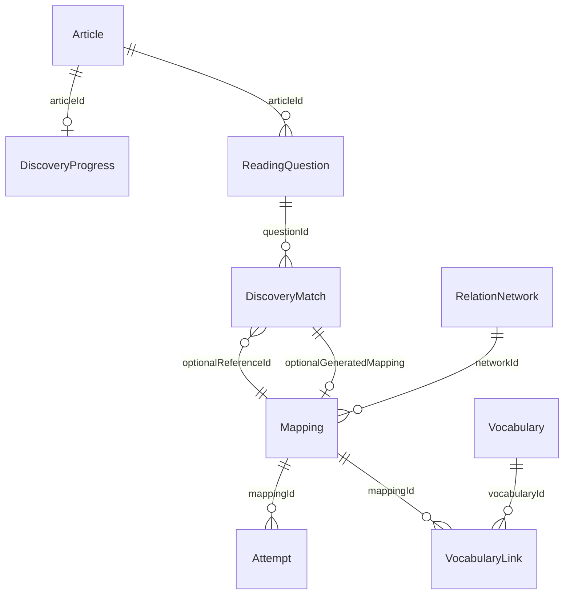

# Reading 自主识别学习流程

## 页面与使用方式

文章默认进入「原文 + 逐题自主练习」，不会渲染原来的错题答案区或 Synonym Mapping 总结。

1. 在题干中用鼠标拖选文字，点击「设为题干表达」。
2. 在原文中拖选对应表达，点击「设为原文表达」。两侧的选择草稿立即保存。
3. 点击「建立对应关系」。每题可建立多组关系，可修改和删除。
4. 需要线索时使用 Hint 1（段落）、Hint 2（完整句子）、Reveal（解析）。
5. 完成本轮后生成总结，或查看实时学习报告。原有资料管理可通过「查看 / 编辑解析资料」明确打开，不删除已有功能。

原文保留真实全文和段落结构。没有全文或题目时会要求补录，不将定位句伪装成完整文章。

## 标准参照与核对边界

Mapping 新增可选 `isStandard`。**旧的普通笔记不自动成为标准答案**；在替换编辑器中明确勾选「作为本题标准参照」后，才参与核对。

核对是确定性的文本与位置检查，不是 AI 语义判分：

- 题干表达与原文表达忽略大小写和连续空白后，须与已录入标准相同。
- 原文选择必须落在标准指定的完整句子内；段落标识用于区分重复语句。
- 标准无法在当前题干/全文中定位，或本题没有标准时，保存为待核对关系，不判正确或错误。
- 没命中标准只说明没有命中已录入的参照，**不代表其他语义对应一定错误**。用户可以重选或进行人工核对。
- 已匹配成功后展示的是标准中实际录入的中文意思、逻辑、原句、替换链与用法边界。不自动编造近义词解释。

## 数据仍属于同一个 Workspace

继续使用 `ielts-workspace.data.v2`，只增加兼容字段，不新建另一套知识库。



- `DiscoveryMatch`：两侧字符区间、选中文字、文本版本指纹、题目/文章 ID、核对结果、识别方式、颜色、操作历史，以及可选参照/知识记录 ID。
- `DiscoveryProgress`：当前题目、各题的选字草稿和编辑目标、各标准已经使用的提示/解析级别、结束本轮时间。
- 标准匹配成功时复用原 Mapping ID，不再生成一份重复总结。词汇与网络仍使用原有多对多关联和人工确认机制。
- 无标准关系先作为 DiscoveryMatch 待核对保存。整理时须补齐语境解释并显式勾选人工确认，才进入 Synonym Index / Review；它不会因此被算作自主识别成功。
- 自定义关系更改选择时，保留已有解释和词汇关联，暂停复习并解除原网络分组，标记「待重新核对」。人工确认后可继续沿用同一 Mapping ID，恢复复习及选择网络。

## 标注与文本编辑

原文和题干的原生鼠标选区转换为 UTF-16 字符区间；使用原文版本指纹与原始片段二次校验。

- 相同单词在另一句或另一段出现，不会仅凭词面相同被标为命中。
- 成功关系两侧同步高亮，颜色持久保存；点击标注或使用关系记录中可键盘操作的定位按钮，可跳到另一侧。同一片段关联多组表达时使用柔和分层高亮，重复点击可逐组定位。
- 修改原文或题目后，旧标注保留历史，但不再对过期位置进行高亮或计入有效自主成功。需要重新选字核对。
- 原文或题目未改变时，刷新、切换文章与切换题目都能恢复标注、草稿和进度。

## 识别结果与 Review

识别方式按**第一次真正命中该标准之前**已经使用的帮助确定。段落提示覆盖同段标准，句子提示覆盖同句标准，避免换一组表达就绕过已经使用的线索。Reveal 直接解释的关系计解析曝光，同句其他关系至少计句子提示：

| 情况 | 记录 |
| --- | --- |
| 未使用帮助就命中标准 | 自主识别成功 |
| 先用 Hint 1 / Hint 2 再命中 | 提示后识别 |
| 先 Reveal / 展开解析再命中 | 解析后识别 |
| 没有标准，仅人工确认 | 人工核对自定义，不计自主成功 |

已经自主找到后再阅读解释不会倒改原始成功结果；但删除标注也不会抹掉已经看过答案的记录。提示/解析信息保存在同一 Workspace，重选或刷新不能绕过。

从 Synonym Index、词汇语境、关系网络、历史或复习答案查看标准内容，也登记解析曝光。仅浏览已有知识不会擅自降低原有掌握状态；自主练习中未能独立找到的内容进入待复习。

Review 保留双向回忆、自评、连续两次成功标记掌握和失败回到待复习的机制。提示/解析后重新识别会为该次学习设置新的复习起点，旧的历史成功不能直接冒充本轮连续答对。未人工重新确认的自定义关系不会作为正确答案进入 Review。

## 学习报告

报告实时从实际匹配操作计算，不用文章成绩推算识别次数：

- 自主 / 提示后 / 解析后数量，按当前有效的标准参照去重。
- 待核对、自定义人工确认和过期标注分别标注，不混入自主成功。
- 尚未掌握数量与优先复习表达读取同一套 Mapping 状态；未确认的自定义关系单独统计。
- 生成总结会明确显示答案并记录解析曝光；**仅看解析但没有建立匹配，不会凭空增加解析后识别数量**。

## 删除规则

- 删除自主标注：保留既有标准参照；若是该标注创建的自定义总结，则一并清理该总结、关联与对应复习历史，词汇保留。弹窗说明影响。
- 删除替换：清理其标注指针、提示记录、词汇关联和复习历史。
- 删除错题或文章：清理所属匹配、草稿、曝光与进度；不删除跨文章共享的词汇和其他文章的网络来源。
- 写入仍是完整 Workspace 一次保存，写入成功后才更新状态；失败不提交部分关系。

## 本轮文件

| 文件 | 职责 |
| --- | --- |
| `src/lib/discovery.ts` | 自主练习类型、选区、定位、标准核对、报告与引用校验 |
| `src/lib/discoveryActions.ts` | 提示曝光、建立/编辑/删除关系、与知识状态的原子联动 |
| `src/components/reading/DiscoveryPractice.tsx` | 逐题学习、选择、提示、匹配、报告 |
| `src/components/reading/SelectionText.tsx` | 原生文本选区与可定位的同色标注 |
| `src/discovery.css` | 复用现有设计变量的新模块样式 |
| `src/lib/reading.ts`、`src/hooks/useNotes.ts` | 扩展统一数据、清理、复习资格与优先级，兼容旧数据 |
| `Reading.tsx`、`Forms.tsx` | 学习先行的页面入口、参照标记、人工核对与已有表单复用 |
| `MappingList.tsx`、`RelationNetwork.tsx`、`VocabularyConnections.tsx`、`SynonymReview.tsx`、`src/App.tsx` | 各入口的答案曝光登记、待核对状态和深链接 |
| `src/main.tsx`、`package.json` | 样式入口与测试命令 |
| `scripts/discovery-model.test.cjs`、`scripts/discovery-smoke.cjs` | 模型测试、真实鼠标拖选和完整学习链路浏览器测试 |
| 既有 Reading 测试脚本 | 调整为显式展开解析后继续验证旧资料管理能力 |

## 测试

```sh
npm run test:reading
npm run test:discovery
npx tsc --noEmit
npm run build
# 另需本机提供 Playwright / Chromium，且开发服务器已启动
PLAYWRIGHT_MODULE=/path/to/playwright npm run test:discovery:browser
```

浏览器脚本通过真实鼠标按下、拖动、松开操作选择文字，不是直接向表单写入答案。截图中的 DEMO 标准与操作只存在于测试上下文，应用不会默认注入测试数据或覆盖用户资料。
