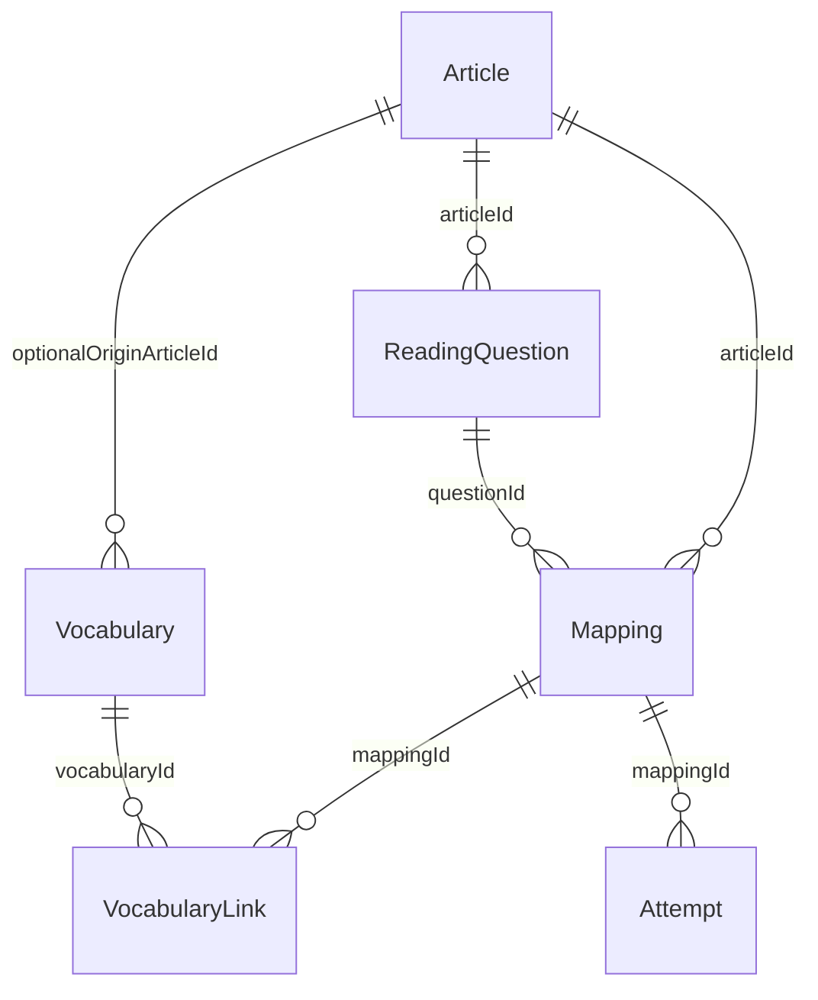
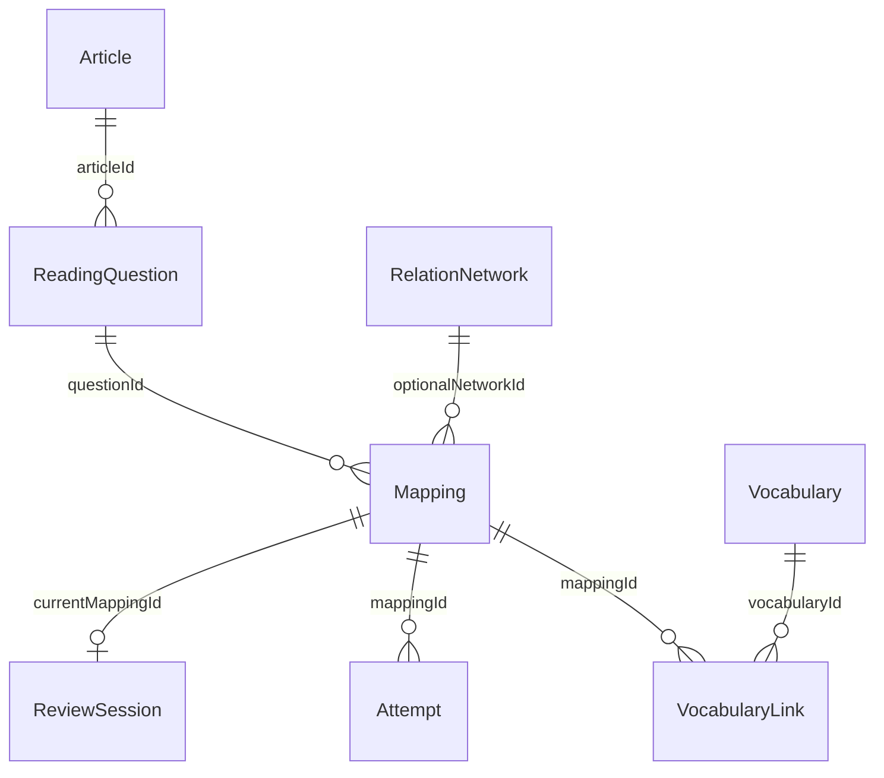

# Reading：文章、替换与复习的统一数据关系

当前存储入口为 `useNotes`。所有页面读取同一个 `Workspace`，不存在 Reading、Vocabulary、Review 各自维护的替换副本。



- **Article**：UUID、文章标题、练习日期、总题数、正确题数、全文和译文。未填写成绩显示 `—`，不根据错题数量推算成绩。
- **ReadingQuestion**：复用 `Note` 的 `subject: Reading`，通过 `articleId` 指向文章。题号、题型、题目、答案、错因、定位句、译文、对应关系与段落均单独保存。
- **Mapping**：独立 UUID，包含 Article ID、Question ID、Paragraph、双侧表达、中文解释、六种关系类型、上下文、替换链、初练识别状态和复习状态。新建时需明确选择关系类型；没有把关系统一处理成近义词。
- **Vocabulary**：复用现有词汇 Note。中文释义、搭配、例句和替换链沿用 `fields`；可有来源文章 ID 和名称快照。
- **VocabularyLink**：`mappingId + vocabularyId` 唯一组合，支持多对多。词汇不复制映射对象；Mapping 不要求必须转为词汇。
- **Attempt**：UUID、Mapping ID、回忆方向、输入回答、自评是否认出和时间。每次提交作为独立历史保存。

## 操作流程

1. 新增文章，填写练习信息；进入详情后新增错题。
2. 从具体题目或文章替换区创建 Mapping，指定题目 ID、关系类型、段落和上下文。
3. Mapping 编辑器可多选已有词汇；也可在 Mapping 下新增词汇并多选替换。
4. Vocabulary 详情展示所有关联语境，可以管理关联、返回文章与原题。来源文章和映射都通过 ID 查找，标题修改不影响关联。
5. Review 切换到 Synonym Review，选择题干 → 原文、原文 → 题干或随机方向，回忆后翻开，自评提交结果。

## 复习策略

这是可解释的加权随机抽查，不是自动语义评分，也不是精确到期日的间隔重复算法。

- 待复习基础权重 2；初练未认出额外 5；上次自评失败额外 4。
- 已掌握权重固定 0.25，仍能被抽到。
- 多条记录时避免连续抽取同一条；仅一条时允许再次回忆。
- 连续两次自评成功标记已掌握；失败立即回到待复习。也可以在替换列表手动切换状态。
- 初练识别状态保留历史含义，不被复习结果覆盖；每次复习结果单独保存。

## 删除与一致性

每次变更先做关联校验，再将整个 Workspace 通过一次 `localStorage.setItem` 写入；写入成功后才更新 React 状态。写入失败不提交部分数据，表单保留。

| 删除对象 | 清理内容 | 保留内容 |
| --- | --- | --- |
| 文章 | 文章错题、文章替换、对应关联与复习历史 | 所有词汇；保留来源名称快照，解除失效来源 ID |
| 错题 | 该题替换、对应关联与复习历史 | 文章、词汇、其他错题 |
| 替换 | 该替换关联与复习历史 | 错题、文章、词汇 |
| 词汇 | 该词及其关联 | 替换、文章、其他词汇 |

重命名文章会同步题目展示名，文章和题目 ID 保持不变。相同题号的新错题会被提示编辑已有题目；相同题目、关系类型和双侧表达的替换不会重复创建；新建已存在的同名单词会提示关联现有词汇。

## 存储与迁移

- 当前 key：`ielts-workspace.data.v2`。
- 原 `ielts-workspace.notes.v1` 仅作为保留的迁移来源/备份，不再是实时数据源。
- 首次读取旧笔记时，按旧文章名建立文章档案并分配稳定 UUID。保留原错题、原始自由文本和词汇来源；不猜测练习日期或成绩，不自动将自由文本误判为结构化 Mapping。
- 迁移写入成功后才启用新数据；失败或结构损坏时暂停保存，避免覆盖资料。
- 数据仍只存储在当前站点浏览器；没有账号、云数据库或跨设备同步。迁移前保留的 v1 数据不会继续更新，不能视为持续备份。

## 验证命令

```sh
npm run test:reading
npx tsc --noEmit
npm run build
```

浏览器测试需要独立安装 Playwright 与 Chromium，开发服务器运行后：

```sh
PLAYWRIGHT_MODULE=/path/to/playwright CHROMIUM_PATH=/path/to/chromium npm run test:reading:browser
PLAYWRIGHT_MODULE=/path/to/playwright node scripts/reading-storage.cjs
PLAYWRIGHT_MODULE=/path/to/playwright node scripts/smoke.cjs
```

浏览器脚本使用独立临时上下文，DEMO 标题仅用于测试与截图，应用不会默认注入演示数据。

## 第二轮：跨文章网络与持久化回忆会话



### 语境关系与网络

Mapping 新增 `sentence`（完整原句）、`rationale`（当前语境为什么可对应）、`usage`（用法边界）和可选 `networkId`。新建或编辑时须补齐原句、上下文、中文意思、替换链与解释；旧记录仍可读取和复习，缺失内容明确提示补充，不自动捏造解释。

RelationNetwork 独立保存名称、表达集合、用法类别、共同边界与 DEMO 属性。一条网络包含多篇文章的独立 Mapping 来源，每条来源仍保有原来的文章/题目 ID、段落、原句、识别情况及复习状态。

用法类别区分：完全同义（限定用法）、语境近义、词形变化、短语/句子转换、其他解释/逻辑对应。Word Form 只能归入词形类；Paraphrase 只能归入表达转换类；其余逻辑/解释关系不能伪装成词汇同义。Synonym 可由用户选择限定用法的完全同义或语境近义。

**没有自动语义合并**：用户明确确认网络归属，系统不凭拼写相似或共享一个词做传递闭包。相同词集合但不同含义边界可以是不同网络。相同类别、相同表达集与相同边界的重复新网络会被拦截，提示选择已有网络。词汇通过已有 Mapping 的多对多关系进入网络，不复制或改写词汇记录。

### 统计口径

| 名称 | 口径 |
| --- | --- |
| 练习正确率 | 用户填写的 correct / total，四舍五入为整数百分比 |
| 练习错题总数 | total − correct；未填写成绩时保持未知 |
| 已整理错题 | 当前文章/资料范围内的实际 Reading Note 数量 |
| 待补录 | max(练习错题总数 − 已整理错题数, 0) |
| 已整理超过练习错题数 | 显示核对警告，不擅自修改成绩或删除笔记 |
| 替换记录 | 按来源语境计数，同一网络在两个文章出现算两条 Mapping |
| 待复习替换 | 同范围 Mapping 中 status = 待复习；Reading 与 Synonym Review 使用同一函数计算 |
| 侧栏 Review 徽标 | 全库待复习错题 + 词汇 + 替换，独立于页面的资料筛选 |

文章编号从稳定文章 ID 派生（`R-XXXXXXXX`），不会随搜索结果顺序变化。完整关联继续使用 UUID，不用截短编号做外键。

DEMO 与真实数据可分别筛选，也可选择“全部（含 DEMO）”。旧示例中以 `DEMO` 开头的标题仍标为示例，新的文章还可显式设置 `isDemo`。DEMO Mapping 不能并入真实资料网络；已有用户记录不会被演示数据覆盖。截图数据只存在于自动测试的独立上下文中。

### 复习与刷新

`reviewSession` 与笔记、网络、替换、历史保存在同一个 v2 Workspace 中，包含当前 Mapping、方向、资料范围、抽取范围、输入内容、揭晓状态、已提交 Attempt ID。

- 新卡片只显示单侧表达。中文解释、原句、上下文、替换逻辑、链路与来源在翻开后展示。
- 刷新恢复同一卡片和输入；若此前已经揭晓，明确显示继续上次进度，而非伪装成新卡片。
- 提交 Attempt 与更新掌握状态、会话提交标记使用同一次 localStorage 写入。刷新后已提交按钮保持禁用，避免重复记答。
- 切换方向或下一条会创建新的未揭晓会话。实际回答结果仍是自评，不是 AI 或精确字符串判分。
- 删除当前 Mapping / 题目 / 文章时清空失效会话；其他来源的网络语境不受影响。
- 删除网络只解除分组，保留各来源 Mapping、词汇与复习历史。来源全部删除后空网络保留供再次关联，也可手动删除。

旧 v2 数据缺少 networks / reviewSession 时，在内存中使用空值兼容，原笔记和 ID 不变；下次成功操作才连同其他数据一起保存。没有再引入互相不一致的多套存储。

### 共用界面规范

`StudyUI.tsx` 提供共享统计、资料范围选择、标签和工具栏；`study-system.css` 使用 `--study-*` 变量管理标题区高度、卡片圆角/边框、控件高度、字体层级与间距。规则限定于 Reading / Review 和对应组件，不重设 Home 主题。

第二轮浏览器验证：

```sh
PLAYWRIGHT_MODULE=/path/to/playwright node scripts/reading-round2.cjs
```

脚本覆盖跨文章分组、用法隔离、词汇语境返回、资料筛选、计数一致性、双向隐藏答案、刷新恢复和防重复提交、编辑、删除清理，以及旧 v2 兼容。并排截图由浏览器渲染两个真实 1440px 页面生成，无截图拼贴或后期修改。
